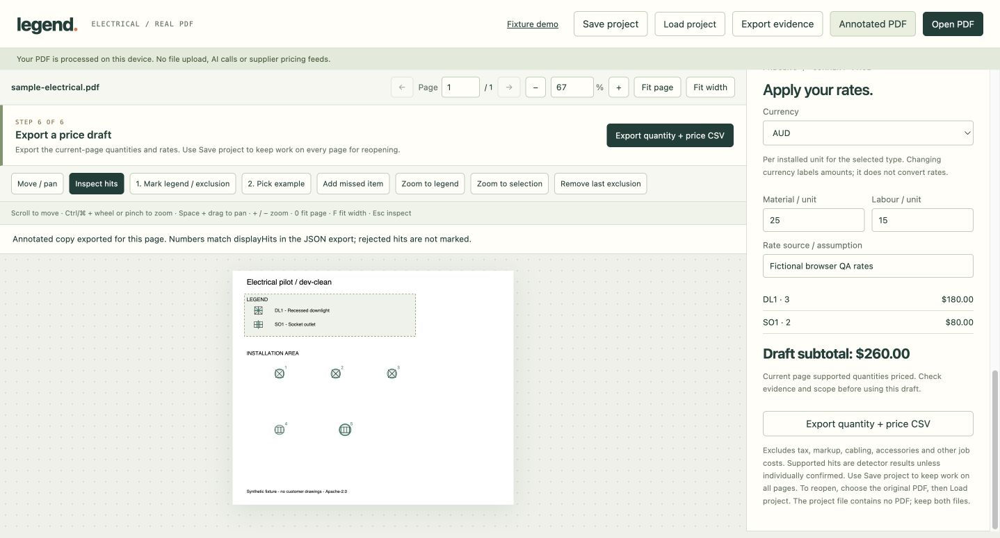

# Legend-guided takeoff pilot

A local, standalone experiment for two declared electrical symbol types (DL1 and SO1), on one digital PDF page at a time. It reuses `scanDocAt`, `vectorDocPage`, text extraction and rendering from the existing headless API. No shared source, package dependencies or lockfiles change.

## Run

From the repository root, with Node >=22.6:

```sh
npm ci
node experiments/legend-takeoff/run.mjs
node experiments/legend-takeoff/serve.mjs
```

Open http://127.0.0.1:5174 for the landing page, then choose **Open your drawing** (or go directly to http://127.0.0.1:5174/workspace.html; saved fixtures remain at /review.html). Stop the server with Ctrl-C. This serves only the experiment folder on loopback. The runner regenerates six original PDFs and six annotated copies under `output/`, plus evidence JSON, positioned legend JSON, drawing PNGs, `quantities.csv` and `report.json`.

No credentials needed. No network calls in the runner. AI review is **not implemented or replayed**; its comparison rows are explicitly not assessed. Live AI review requires a separately declared call/spend budget and a server-side environment key before implementation.

## Inputs and provenance

`fixtures.json` contains authored symbol placements, manual exclusion regions are declared by the generator, and baseline exemplars are selected at known legend coordinates. This is synthetic oracle ground truth authored before the first scan, **not independent human annotation**. Everything is original and shareable under the repository Apache-2.0 licence. No customer drawings or downloaded model files are included.

The development family is `a` (three sheets); held-out sheets use different geometry families `b` and `c`. The protocol and matching rules were fixed before the initial scanner run. Held-out outcomes were inspected for this report but were not used to tune detection or parsing. This six-sheet pilot is smaller than the mission's suggested 6+6 and cannot establish field accuracy. The test-missing and test-ambiguous cases intentionally expose failure modes.

The parser is deliberately narrow: it searches manually selected legend bounds for a declared code, groups horizontal text, and requires exactly one small vector path to the left. It preserves source text, candidate bounds, association state and exemplar. It does not understand arbitrary legends, multi-path symbols, scans or cross-page exemplars. A missing legend currently yields no extracted entries and two not-assessed quantity rows. Automatic legend discovery and external PDF input are not implemented.

All coordinates carry page 1 and `pdf-points-bottom-left`. Raster display uses the pdf.js viewport transform; conversion round trips are checked. IDs combine source PDF SHA-256, page, type and a hash of coordinates rounded to 0.001pt. Identical source/scan results keep identical IDs. Scans always start from original bytes and never append old markups. Within-type hits within 3pt are deduplicated in sorted coordinate order; different types are not merged.

## Reproduce evaluation

```sh
node experiments/legend-takeoff/run.mjs
npm run bench
npm run build
```

Matching is maximum-cardinality, one-to-one, same type, within 10 PDF points. No hit or truth can be matched twice. Unassessed types have blank quantities and count-error fields; their truth instances remain misses for end-to-end recall. Precision is null without detections. Report both coverage and assessed exact counts so unavailable results cannot masquerade as zero error.

Manual baseline input is one exemplar per available type. Extracted runs share one manually selected primary legend region per sheet with a legend. The repeated-legend sheet also has a second manually declared exclusion region. These selection counts are inputs, not measured user interaction time. No human corrections were applied in evaluation. Runtime in the report measures each scan and hit processing, excluding fixture generation, rendering and legend extraction; sub-millisecond values round to zero.

| Split | Configuration | Correct | Incorrect | Missed | Precision | Recall | Assessed page/types | Exact assessed counts |
|---|---|---:|---:|---:|---:|---:|---:|---:|
| Development | Manual exemplar | 11 | 0 | 0 | 100% | 100% | 6/6 | 6/6 |
| Development | Extracted legend | 11 | 0 | 0 | 100% | 100% | 6/6 | 6/6 |
| Held-out | Manual exemplar | 8 | 3 | 3 | 72.7% | 72.7% | 4/6 | 2/4 |
| Held-out | Extracted legend | 6 | 2 | 5 | 75.0% | 54.5% | 3/6 | 2/3 |
| Both | Extracted + AI | — | — | — | — | — | Not assessed | — |

Extracted legend associations: 9 supported, 9 correct against authored exemplar coordinates, 1 unresolved association on present legends. Two additional types have no legend on test-missing. Each configuration's per-type metrics, absolute count errors and scanning provider are in `output/report.json` and `output/quantities.csv`. All assessed scans in this run used the vector provider. Cloud calls: 0; API cost: $0.

The parser rejected the ambiguous DL1 association. SO1 still falsely matched both octagonal DL1 installations on family c. The manual baseline also cross-matches the lookalike geometry. The negative result demonstrates why stable evidence and a review step matter; no claim is made that extraction improves accuracy. A manual baseline in the ambiguous sheet can itself be contaminated by adjacent legend geometry.

## Two-minute demo

1. Open `dev-clean`: select a quantity row and inspect a numbered hit; green boxes indicate legend associations.
2. Open `dev-repeat`: show that repeated legend examples are excluded.
3. Open `test-transforms`: inspect rotation/size matches.
4. Open `test-ambiguous`: DL1 is not assessed; SO1 shows two false positives. Click a numbered false positive and flag uncertain or reject it. Totals recalculate in code.
5. Download reviewed JSON/CSV. These preserve original evidence and separate timestamped human decisions; they do not overwrite benchmark results. Review state survives drawing/method changes in the tab but is lost on reload unless exported. Corrections cannot be imported yet.
6. Open the original annotated PDF and JSON from the same run. The PDF is the original detector output; browser review decisions do not regenerate it.

## Validation and remaining work

Initial checkout: `e0d57e3a463297b1580f72bf647f3dfe7bbf3083`. The report also records Node, commit and fixture-protocol hash. The saved report identifies the engine baseline used for the initial run. The experiment implementation is versioned in Git; rerunning records the current checkout commit.

- `npm ci`: completed.
- `npm run bench`: passes, no regressions; one declared pre-existing diagonal room gap.
- Initial `npm run build` (before the reliability fixes below): `scripts/check-scaled-bench.mjs` failed its generator determinism check against committed `questions.jsonl`, before full app typechecking/bundling. This occurred on the untouched checkout before any experiment files were written. Engine checks through scanning/openings passed. The later compatibility fix preserves this check and the committed questions; room code and scorers remain unchanged.
- Runner protocol checks cover one-to-one scoring, augmenting-path matching, deduplication and PDF/raster round trips.
- All six annotated PDFs were rendered and visually checked.

Next: obtain tracking-issue acknowledgement, independent human labels and permission-cleared real electrical sheets; test multi-path legend crops; add budgeted AI review only if it can resolve the documented lookalikes. Keep this fixture set frozen for comparisons. Full mission completion requires that broader evaluation, real input workflow, AI comparison where applicable, and a reviewed draft PR.

`tracking-issue.md` is prepared locally. The initial experiment was pushed to the private `chid/pdf2takeoff-legend-takeoff` repository; subsequent landing, pricing and research edits are local until pushed. No tracking issue or PR has been created. Record AJ's acknowledgement in the issue before upstream integration. Do not merge or deploy as part of this experiment.

Initial additional verification: standalone `npx tsc --noEmit` and `npx vite build` both pass, isolating the combined build failure to the pre-existing engine benchmark check. A second experiment run preserved hit IDs and counts exactly. Chrome review UI was checked: selecting a hit reveals provenance; flagging it uncertain decreases supported and increases unresolved totals; reloading restores original results. Test review changes were discarded.


## Landing page and pricing worksheet

The local server opens the Legend landing page at `/`. Its four-step interactive plan is an illustration, clearly separated from the actual fixture evaluation. `/review.html` opens the working evidence and pricing demo. The public demo is deployed through Sites; see HOSTING.md. Browser workspace edits are published using the same site identity.

Pricing uses entered material and labour rates per installed unit, decimal amounts to two places, and integer cents for arithmetic. Empty or invalid rates stay unpriced; explicit zero is allowed. Supported quantities are priced; unresolved detections are excluded and unassessed types have no line price. Currency labels amounts without conversion. Rate source notes, original evidence and separate review decisions are included in the JSON price draft; CSV provides the priced lines. Fictional sample rates are labelled as assumptions. Subtotals exclude tax, markup, cabling, accessories and other job costs. Rates and review decisions stay in the browser tab until exported.

Run `node experiments/legend-takeoff/check-pricing.mjs` for arithmetic and missing-data checks. The landing page has static, script syntax and HTTP checks only, with visual QA outstanding. The local workspace browser checks are recorded below.


## Reference research and planned history

[Local feature plan](feature-plan.md) records the 2026-10-20 EasyPDFTakeoff homepage review, independent commentary and a prioritized history roadmap. [Asset provenance](assets/README.md) documents the original history illustration and external references. The landing page labels history as planned. Local project save/reopen is now available in the real workspace; activity logs, snapshot comparison and rate versioning remain planned. No third-party visual assets or marketing copy are reused.


## Real PDF workspace

Open `/workspace.html` to use an actual PDF. The drawing stays on-device. The browser uses the existing vector scanner and a CV fallback; no trained model, OCR or cloud AI is loaded. PDF worker, font maps, standard fonts and decoder assets are served from the same site. This is a digital-PDF-first workflow, not validated accuracy on arbitrary plans.

1. Open a PDF or load the shareable sample.
2. Drag an exclusion around the full legend. Repeat for any other legend/schedule examples.
3. Enter a code/description and choose **Use this type**. Choose **Pick example**, then click that type's legend symbol.
4. Choose **Find matching symbols**. Review hits; confirm, flag or reject them. Use **Add missed item** for manually confirmed installations.
5. Enter material/labour rates and a source note. Export current-page evidence JSON, quantity/price CSV and an annotated PDF copy.

Each page has its own examples, exclusions and scans; navigating pages does not reuse coordinates from another page. Re-scanning a type replaces its detections, retains decisions for stable IDs, and avoids duplicate manual additions. Nearby conflicting classifications are flagged uncertain separately from human review decisions; rejecting a competing classification clears the derived conflict. Re-scanning a rejected classification preserves the resolved decisions. A truncated scan cannot be treated as complete pricing coverage. Missing assessments/rates stay distinct from zero.

The JSON export contains original source SHA-256, page/frame, raw hits and excluded regions, display numbering, decisions and rate assumptions. The annotated PDF preserves the source document, marks only this page, omits rejected hits and retains display numbers. Rates are shared by equipment code within the open document. Manual decisions are current state, not an immutable activity history. Use **Save project** before closing to retain every page. To reopen, open the original PDF and choose **Load project**. The SHA-256 must match; the project does not contain the PDF. Evidence exports remain current-page reports and are not project files.

Development: `node experiments/legend-takeoff/serve.mjs` (Vite, port 5174).
Production: `npx vite build --config experiments/legend-takeoff/vite.config.mjs`; merge `.build/` into the static site's `dist/`. Vendor PDF rendering resources are copied from the installed pdfjs package at config load; generated directories are ignored by Git.

Validation: `node experiments/legend-takeoff/check-workspace.mjs` uses real PDF parsing/rendering/scanning inside a small DOM harness. It covers exclusions, stable rescan IDs, review-to-price, rotated crop transforms, image-only fallback, annotation export and page isolation. The resampled image-only fixture exposes a known CV miss: only the legend exemplar matches and installation recall is zero. The UI warns that no supported count does not establish no equipment. This test is not browser or visual QA; separate Chrome checks are recorded below.


## Trade pages and navigation

Dedicated pages are available at `trades/electrical.html`, `trades/plumbing.html`, `trades/hvac.html`, `trades/fire.html` and `trades/data.html`. They link into the real workspace with a `?trade=` parameter and editable code/description presets. The same scanner runs for every trade; presets do not provide trained classification or establish technical specifications. The workspace is still item counting, not length/area measurement. Switching trades adds types without discarding existing results; remaining unassessed types keep pricing coverage incomplete. The sample button explicitly loads an electrical example and its presets.

Trade content lives in `trades.mjs`; regenerate original static pages with `node experiments/legend-takeoff/make-trade-pages.mjs`. Their inline SVG diagrams are illustrations, not standard symbol libraries or measured scanner output.

Drawing controls: **Move / pan**, middle-button drag or hold Space while dragging; Ctrl/Command + wheel or a two-finger gesture to zoom around a point; numeric zoom from 5–800%; **Fit page** (0), **Fit width** (F), **Zoom to legend**, and **Zoom to selection**. +/- zoom, H selects pan and Escape returns to inspection. Editing a text field keeps its normal keystrokes. On touchscreens, use Move / pan or Inspect hits for two-finger zoom. Plain scrolling still moves the drawing. Zooming preserves the selected evidence hit.

Checks use a controller/DOM harness with real PDF rendering and exercise anchored zoom, drag scroll, fit calculations, selection retention, text-field keyboard protection and trade-presets retention. Chrome checks additionally exercised typed zoom, pointer panning, fit, example selection and text-field shortcut protection.


General builders: `trades/general-builders.html` opens the workspace with editable door-set, window-unit and joinery-unit presets. Counts can be reviewed alongside other trades without clearing existing results. Repeated details may need manual additions; specifications and drawing schedules still need review. Floor/wall measurements, structural quantities and complete building estimates are outside this counting workflow.


## Application reliability update

The real-PDF controller now prepares a replacement PDF’s first rendered page before switching documents, preserving the active drawing, quantities and rates when parsing or rendering fails. Page navigation failures return to the previous page. File reads and sample fetches hold the busy state; a failed sample does not switch trades. Zoom and fit redraws preserve draft equipment inputs. Rescans retain manual confirmations/rejections and their original IDs when the detector finds a nearby match, rather than replacing the human-reviewed item. Controller regression checks cover these cases.


Presenter materials: [main talk track](demo-talk-track.md) contains a rehearsable three-minute script, sample setup, failure language, judge answers and a thirty-second version. [Public demo guide](demo-guide.html) links to that script and the real workspace. The script distinguishes live on-device processing from synthetic fixture evidence and uses fictional rates only.


## Priority reliability fixes (local)

- Counts, prices and annotated exports exclude hits outside the PDF's visible page bounds, including rotated crops. Raw scan hits remain in the evidence.
- Changing an exemplar marks the previous scan stale. Its original exemplar and raw hits are retained, pricing becomes unassessed, and annotated export requires a fresh scan. A failed rescan retains that stale state.
- **Exclude this type from scope** removes unused presets from the current page's pricing coverage without treating them as zero. Evidence and rates remain available when the type is included again. JSON and CSV explicitly identify out-of-scope lines.
- Opening a replacement PDF or loading a project asks before discarding unsaved work. Failed parsing, source verification or rendering retains the active work.
- **Save project** downloads a version 1 JSON file with every visited page, selected page/type, original scan evidence, current decisions, exclusions, scope, currency, shared rates and draft equipment inputs. **Load project** validates the schema and original PDF hash, rebuilds crop bounds from that PDF, and recomputes quantities and prices. Unknown versions and invalid files are rejected without changing the original file. This is explicit file saving, not autosave or an immutable activity history.
- Save validates the same schema and 20 MB byte limit as load before downloading or clearing the unsaved state. Invalid data and export errors retain the current work and show an error.
- CI runs Legend's focused checks and production build as a separate job. The historical root-build determinism failure was traced to native random-comparator sorting; the benchmark now uses a fixed ordering that reproduces the committed sample without regenerating its questions or changing scorers.

Controller regression checks cover these cases with real PDFs. These changes are local until separately published; HOSTING.md records the deployed version.

## Local browser QA — 2026-10-20

Tested `/workspace.html` in Chrome on macOS, using the synthetic electrical
sample and a temporary two-page copy whose second page is cropped and rotated
90 degrees. No customer drawings were used. Desktop layout and a 390 × 844
viewport override were checked; the override was reset afterwards.



| Scenario | Observed result |
| --- | --- |
| Guided sample → scan → review → rates | Three downlights and two sockets; all five confirmed. Fictional rates of 40 + 20 and 25 + 15 produce AUD 260. CSV values match. |
| Onboarding review and remaining types | Review now focuses the visible Confirm button after zooming. Completing a reviewed, priced type now leads to the next unfinished included type. |
| Confirm, flag, reject and rescan | Quantities follow decisions. Conflicting types retain the original confirmations; rejecting the duplicates and rescanning restores the three confirmed downlights. |
| Scope and changed example | Excluding an unused type removes its pricing gap; inclusion restores it. A changed example shows “Rescan required,” removes its price, and blocks annotated export until rescanned. |
| Save, load and export | Project JSON, CSV and annotated PDF download. Loading the saved sample project restores all five confirmations, rates and the AUD 260 draft. Unsupported project versions retain the open work. |
| Invalid save and recovery | A 101-character pasted numeric rate passes the browser's input validation but exceeds the project schema limit. Save now rejects it and retains all three detections. Correcting the rate downloads a project accepted by the loader; the unsaved-warning behavior also passes regression checks. |
| Native reload protection | Chrome's native reload displayed the unsaved-changes warning; after cancellation the three detections remained. The automation reload command bypassed this prompt, so it is not a valid substitute for the native check. |
| Native PDF replacement cancellation | Selected the temporary two-page PDF through the macOS file picker, then clicked Cancel in Chrome's discard confirmation. The original one-page sample, three downlights, one confirmed hit, unsaved material/labour rates of 99 + 20, rate-source note and AUD 357 subtotal remained. |
| Native project loading cancellation | Selected the matching saved sample project through the macOS file picker, then clicked Cancel in Chrome's discard confirmation. The workspace reported “Project loading cancelled. Current work retained.” The same drawing, counts, review decision, unsaved rates, note and AUD 357 subtotal remained. |
| Manual PDF setup | Native file picker, legend drag, example click and scan produce three downlights on page one. |
| Rotated crop and multiple pages | Page two retains four raw scanner matches but displays/counts zero because all are excluded or outside its crop. Returning to page one retains its three detections. Saved project contains both pages. |
| Navigation and narrow layout | Typed numeric zoom, pointer panning and fit work. Typing shortcut characters in Description leaves zoom unchanged. Narrow layout has no horizontal page overflow; review controls are reachable. |

The zero-count message was corrected so rejected or uncertain matches are not
described as absent detections. Focused regression checks cover the new guide
transitions; `node scripts/legend.mjs build` passes after these changes.

Limits: this is Chrome QA on synthetic PDFs, not field-accuracy validation.
The narrow check is viewport emulation, not a physical touchscreen or Safari/
Firefox test. On narrow screens, the drawing and review controls require
separate scrolling. Wrong-PDF rejection and injected loading failures remain
covered by the controller harness. The extension's direct file upload API was
unavailable; native macOS file pickers and Chrome Cancel buttons were used for
the completed replacement-cancellation checks. Console errors
observed in the fresh QA tab came from another Chrome extension, not the
workspace.
