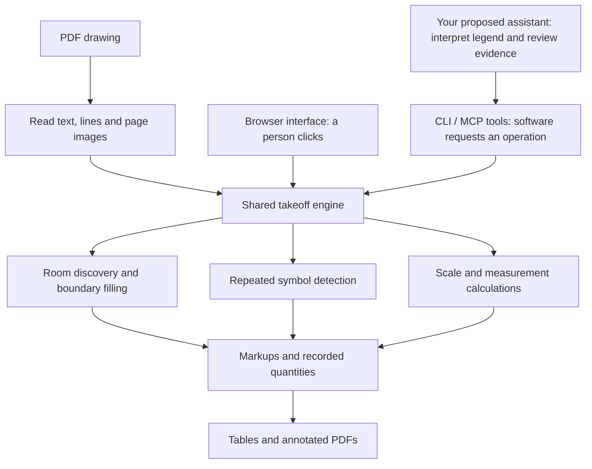

# Your mission: turn a drawing’s legend into a checkable takeoff

**For:** AJ’s hackathon teammate  
**Project:** [pdf2takeoff](https://github.com/ajflow/pdf2takeoff)  
**Handoff snapshot:** 20 October 2026  
**Ownership:** legend-guided electrical symbol counting, from experiment to demonstrable result

You do not need to become a construction expert before starting. Your job is to help the software understand the symbols used on a drawing, use our existing tools to find them, and show enough evidence that a person can check the answer.

AJ is improving how we find and measure rooms. You will own a complementary problem: **“What equipment does this drawing show, and how many of each item are there?”** You can build and verify your work independently in your own Git branch.

## 1. What is a takeoff?

A takeoff is a list of quantities taken from construction drawings. An estimator uses those quantities to work out materials, labour and eventually cost.

For example:

| Drawing information | Takeoff result | Why it matters |
| --- | --- | --- |
| Outline of a room | Floor area in square metres | Flooring or paint quantities |
| A cable route | Length in metres | Cable quantity |
| Repeated light symbols | Number of lights, grouped by type | Purchasing and installation |

Counting ten lights does not tell us their price, installation difficulty or every accessory needed. This mission produces an evidence-backed quantity list; estimating the complete job is a separate step.

Three useful terms:

- **Legend:** the drawing’s dictionary. It shows a symbol alongside its code and description, such as `DL1 — recessed downlight`.
- **Schedule:** a table of equipment or quantities. A schedule printed on a drawing may describe a different scope, so it is not automatically the correct answer for our count.
- **Calibration:** telling the software how a distance on the page relates to a real distance. Areas and lengths need calibration; symbol counts do not.

A digital PDF may contain actual lines and text, called **vector** content. A scanned PDF is mostly a picture, called **raster** content. Start with digital PDFs: they give us cleaner information and fewer problems to solve at once.

## 2. What we have built

The project already opens drawings, measures geometry, fills room boundaries, finds repeated symbols, records markups and exports results. The important architectural idea is that the user interface and automation tools share the same calculation engine.



**CLI** means commands run in a terminal. **MCP** is a standard way for an AI assistant to call tools. Neither is a second measurement engine.

| Part | Where to look | What it does |
| --- | --- | --- |
| Browser application | [`src/app`](../../src/app) | Displays drawings and handles user interactions |
| Shared engine | [`src/engine`](../../src/engine) | Geometry, scale, fill, scanning and exports |
| Automated operations | [`src/headless/ops.ts`](../../src/headless/ops.ts) | Runs drawing operations without clicking through the app |
| AI tool interface | [`src/headless/mcp.ts`](../../src/headless/mcp.ts) | Exposes operations such as rendering, reading text and scanning |
| Symbol scanning | [`src/engine/scan.ts`](../../src/engine/scan.ts) | Coordinates available symbol detection methods |
| Output | [`src/engine/export.ts`](../../src/engine/export.ts), [`src/engine/annotate.ts`](../../src/engine/annotate.ts) | Exports quantities and drawing annotations |

The scan tools can use vector matching, a locally available trained detector, or computer vision matching. Do not assume trained model files will be installed on your computer. Record which method actually ran.

The existing core performs drawing processing locally. If your experiment sends text or image crops to an OpenAI API, that is an explicit cloud-assisted addition. The demo must say so.

### What exists versus what you are building

Existing tools include opening a document, rendering a page, reading positioned text, scanning from an example symbol and listing markups. An automatic legend reader, legend-to-count workflow and evidence review screen are **proposed additions**, not capabilities you should assume already exist.

Research notes such as [patch plan 3](../research/patch-plan-3.md) contain ideas. Check the implementation before treating a plan as shipped functionality.

## 3. What AJ is working on in parallel

Room extraction has three distinct problems:

1. **Discovery:** find a useful starting point inside each room.
2. **Boundary filling:** grow from that point until the walls stop the fill, like a paint bucket tool.
3. **Selection:** remove duplicates and reject unsuitable results.

AJ’s room work separates those problems into experiments, with a frozen scoring protocol so changes can be compared fairly. External benchmark verification is also underway.

The reported corrected baseline, Goal 0.1, found **15 of 37 rooms**, with **2 incorrect detections**, across seven synthetic sheets. Its room F1 was **0.556**. F1 combines how many detections are correct with how many real rooms were found; it is not “55.6% of all takeoff tasks solved.” The assisted experiments suggest that better starting points could help, but do not establish an automatic performance ceiling.

Those results are from a separate experiment worktree and may not be on GitHub `main`. Start from the available `main`; your work must not depend on AJ’s private filesystem paths or unmerged room commits. AEC and ResPlan results remain unverified in this handoff until the running validation reports otherwise.

Your symbol-counting results need their **own scoreboard**. Do not compare them numerically with room F1 or the previously discussed 82.9 benchmark result: the tasks and scoring rules differ.

## 4. Your mission

> Given a digital electrical drawing with a legend, identify a small declared set of symbol types, find their instances in the drawing, and produce a quantity table where every count can be traced to visible evidence.

The idea worth testing is that the drawing can supply its own symbol examples. We may not need to train a universal detector for every designer’s symbol style to make a useful tool.

For a hypothetical drawing, the experience should look like this:

1. Open the drawing and locate its legend.
2. Read `DL1 — recessed downlight` and associate it with the correct symbol example.
3. Use that example to search the installation area.
4. Show numbered matches, flag questionable matches and exclude the legend itself.
5. Produce a row such as “DL1: 24 supported detections; 2 unresolved.” Those numbers are illustrative, not a result we have achieved.
6. Let someone select the row and inspect the evidence on the drawing.

“Supported” means the configured detection/review process accepted it. It does **not** mean a human confirmed it or that no other instances were missed.

### Start small

The first version should handle **one page at a time, digital PDFs and two or three declared electrical symbol types**. Begin with a manually selected legend region. Then test whether automatic legend discovery adds value.

Do not make scanned plans, all trades, multi-page coordination, pricing, room extraction or model training prerequisites. A small workflow that works and explains its limits is a useful hackathon deliverable.

### Where AI helps

Use AI to interpret descriptions, associate legend entries with candidate symbol crops, and review ambiguous detections. Give it numbered evidence and ask for structured decisions linked to those IDs.

Use code to retain coordinates, deduplicate hits and calculate totals. The model should not invent coordinates or write a final count from memory. Keep model decisions, human decisions and unresolved items distinguishable.

Reviewing detected symbols alone cannot reveal every missed symbol. Your independent test annotations must measure misses too.

## 5. What you own and how to stay independent

Create your experiment under **`experiments/legend-takeoff/`**. This is the proposed home for the runner, fixtures, evaluation, documentation and a small standalone review interface.

Reuse public engine/headless interfaces. If a reusable pure legend parser is justified, propose a new `src/engine/legend.ts`. Inspect existing exports before using them; internal helpers are not automatically public APIs.

| Ownership | Scope |
| --- | --- |
| You | Legend interpretation, symbol association, evidence records, review workflow, symbol-specific evaluation and demo |
| AJ’s room experiments | Room discovery, fill and selection, including `openings.ts`, `dynamicfill.ts`, `fill-vector.ts` and room scoring |
| Coordinate before editing | Shared scanning interfaces, `src/headless/mcp.ts`, the main app UI, package dependencies and lockfiles |

You can finish a standalone experiment and draft PR without waiting for the room work. Main-app integration is a later, small agreed change.

### Important implementation traps

- **Legend symbols are examples, not installed equipment.** Record and exclude legend regions from installation counts.
- **Repeated legends and duplicate hits can inflate totals.** Keep stable hit IDs and one documented deduplication rule.
- **Page coordinates differ from image coordinates.** Headless tools use PDF points with a bottom-left origin; rendered images use a top-left origin. Store page number and coordinate frame, and test conversion.
- **The current all-pages scan reuses the supplied coordinates on each page.** It does not automatically transfer a legend example to another page. Keep version one single-page; cross-page exemplar reuse needs explicit implementation.
- **Text and pictures can be mismatched.** A nearby description is not necessarily the label for a symbol. Preserve the source text and region so the association can be checked.
- **Unavailable is not zero.** Missing legend, unsupported symbol or failed scan should produce an explicit unresolved/not-assessed result.
- **Legend and drawing symbols may differ in size or rotation.** Include those cases in the evaluation rather than assuming the scan supports them.

## 6. Build it in four milestones

### Milestone 1 — Fixtures and a trustworthy baseline

Make a few small drawings with known answers, or use drawings you have permission to share. Annotate installed instances independently of the scanner output. Record legend regions and excluded regions.

Run the existing scanner with a manually supplied example. This tells us what the engine can already do before adding automatic interpretation.

Deliver: fixtures, annotations, a reproducible command and a baseline report. Record the exact Git commit and scanning method.

### Milestone 2 — Read the legend

Within a selected region, extract positioned text and candidate symbol examples. Return entries with a stable ID, code, description, page, source bounds and exemplar reference. Keep uncertain associations unresolved.

Deliver: structured JSON plus an image showing which description was associated with which symbol. Allow corrections and record them; disclose manual input in the evaluation.

### Milestone 3 — Count and review evidence

Connect legend entries to scans. Keep a record for each hit: stable ID, source document/page, location, legend entry, detector method and review state. Calculate schedule totals from those records.

Add optional AI review using small numbered crops and relevant text. Existing page rendering is useful, but a crop/review wrapper may need building. Retain the model ID, settings, structured decisions, latency and API usage. Do not require or store private model reasoning.

Deliver: evidence JSON, a CSV quantity table, an annotated PDF and a simple way to inspect questionable hits. Re-running the workflow must not silently double-count old markups.

Keep API keys in environment variables used by a local runner/server, never in browser code or Git. Declare a maximum call/spend budget before live runs. Without credentials, replay fixtures can verify plumbing, but must be labelled as replay rather than a live AI result.

### Milestone 4 — Evaluate and demonstrate

Use the same test sheets to compare:

| Configuration | What it tests |
| --- | --- |
| Existing engine + manually supplied exemplar | Current detection baseline |
| Extracted legend + engine | Whether legend interpretation improves or harms the workflow |
| Extracted legend + engine + AI review | Whether AI review adds enough value to justify its cost and time |

Record all manual selections and corrections. Keep final evaluation inputs fixed; an assisted correction run is a separate result.

Start with a manageable pilot, for example six development sheets and six held-out sheets from different templates or sources. This is a suggested experiment size, not enough evidence for a broad accuracy claim. Do not put near-identical variants of one template in both groups. Freeze the final group before tuning and disclose any later inspection or changes.

Define the rule for matching a detected location to a known symbol before comparing results. Report:

- Correct, incorrect and missed detections, per symbol type.
- **Precision:** of the symbols we counted, how many were correct?
- **Recall:** of the symbols actually present, how many did we find?
- Exact count accuracy per page/type and absolute count error. Correct totals can hide a missed item and a false detection cancelling each other out.
- Correct legend associations and unresolved associations.
- Manual corrections needed, runtime and API cost.

Include clean drawings, lookalike symbols, size/rotation changes, repeated legends and a missing-legend case. Show failures as well as successes.

## 7. What “done” looks like

You have completed the mission when another person can clone your branch, follow the README, reproduce the reported evaluation and inspect where each reported quantity came from.

The handoff should contain:

- A focused draft PR with setup and reproduction instructions.
- Fixtures and expected answers that can legally be shared.
- Baseline and experiment results, including misses and unresolved cases.
- JSON evidence, CSV quantities and an annotated PDF from the same run.
- A two-to-three-minute demo: open drawing → read legend → count → inspect a questionable hit → export.
- A short decision: what helped, what failed and what we should integrate next.

A well-measured negative result is still useful. We have not agreed an accuracy promise. Passing software checks alone does not prove the takeoff is correct.

For the hackathon, the proposed story is: **“The assistant reads the drawing’s own symbol dictionary and produces quantities you can check.”** Confirm the event’s submission requirements separately; this document does not assume a particular event or judging rubric.

## 8. GitHub workflow, in plain language

The **repository** is the shared project. A **branch** is your separate line of work. A **commit** is a saved checkpoint. A **pull request (PR)** lets AJ review your changes before they enter `main`.

### Set up your own working copy

Install Git and a compatible Node.js 22 release; the package declares Node `>=22.6`. Then:

```bash
git clone https://github.com/ajflow/pdf2takeoff.git
cd pdf2takeoff
git fetch origin
git switch -c codex/legend-takeoff origin/main
git rev-parse HEAD
npm ci
npm run build
npm run bench
npm run dev
```

Save the printed commit ID in your experiment notes. Open the local address shown by the dev server and try the bundled drawing. Learn how manual symbol scanning works before automating it.

If you lack repository write access, use a personal fork and open a PR back to `ajflow/pdf2takeoff`, or arrange collaborator access once. Do not share AJ’s credentials. Use your own clone or isolated worktree rather than changing the branch in AJ’s running workspace.

### Agree the scope once

Read [CONTRIBUTING.md](../../CONTRIBUTING.md). It requires an agreed issue before feature work and discussion before adding dependencies. This document is AJ’s requested mission scope: put it in a tracking issue titled **`[Hackathon] Legend-guided electrical takeoff assistant`** and have AJ acknowledge it there to record that agreement.

After that, proceed independently within this scope. Routine implementation choices do not need repeated approval. Raise changes to scope, shared interfaces, dependencies or integration plans in the issue.

### Work in reviewable steps

Use the milestones above as review checkpoints. Keep each PR focused; do not bundle unrelated fixes or broad formatting changes. Before a checkpoint, run `npm run build`, `npm run bench` and your documented experiment checks. Record pre-existing failures separately from regressions you introduced.

For experiment files, a typical checkpoint is:

```bash
git status --short
git add experiments/legend-takeoff/
git diff --cached
git commit -m "feat: add legend takeoff experiment baseline"
git push -u origin codex/legend-takeoff
```

Stage other intended files explicitly. Do not commit credentials, private customer drawings, downloaded datasets, model weights or unrelated work. Commit only small shareable fixtures and necessary results; document how to obtain larger inputs.

Open a **draft PR targeting `main`**, link the issue and use the [PR template](../../.github/PULL_REQUEST_TEMPLATE.md). Include the problem solved, exact reproduction commands, drawing used, browser/steps, screenshots for UI work and the evaluation table. State whether API calls were live or replayed.

To pick up changes from AJ, first commit your work, then:

```bash
git fetch origin
git merge origin/main
```

Resolve conflicts on your branch and rerun affected checks. Ask AJ to review conflicts in shared interfaces. Do not force-push shared branches, merge your own PR into `main`, or deploy as part of this mission.

### Give updates that AJ can act on

Post a short update at each milestone: **what works, the measured result, what failed, the next experiment, and any specific decision needed**. A screenshot plus a reproducible result is more useful than “the agent finished.”

## 9. Optional stretch: check the drawing against its own schedule

Only after the main workflow works, compare detected quantities with a printed equipment schedule and highlight disagreements. For example: “We found 22 supported DL1 instances; the printed schedule lists 24.”

Treat this as a discrepancy to investigate. The schedule may cover another page, another revision or a different scope. Never adjust the count just to match it. This could become a valuable second demonstration of the assistant finding a review question, with evidence on both sides.

## 10. Copy-paste starting prompt for your coding assistant

```text
Read docs/missions/legend-guided-takeoff.md, CONTRIBUTING.md and any applicable
AGENTS.md instructions. This mission is the agreed scope for my contribution
to pdf2takeoff. Inspect the current checkout and existing scan/headless APIs
before proposing changes; distinguish implemented features from research plans.

Work on codex/legend-takeoff in my own clone/worktree. Build a standalone
experiment under experiments/legend-takeoff/ for single-page, digital electrical
PDFs and a declared set of 2–3 symbol types. Start with a selected legend region.
Reuse the engine; preserve coordinate provenance and stable evidence IDs;
exclude legends from installation counts. Compute totals in code. Represent
unsupported and uncertain cases explicitly.

Start with independently annotated shareable fixtures and an existing-engine
baseline. Then add legend extraction and optional AI review. Compare all three
configurations on the same held-out sheets with frozen matching rules. Report
precision, recall, exact count error, legend association quality, unresolved
cases, human effort, runtime and API cost. Do not tune on the final test set.

Keep room extraction and its scorers untouched. Coordinate shared interfaces,
dependencies and main-app integration through the agreed tracking issue. Keep
secrets and private drawings out of Git. Record cloud calls honestly; do not
present replay output as live model performance.

Deliver reproducible commands, evidence JSON, CSV, annotated PDF, a simple
review demo and a clear evaluation report. Run the relevant project checks.
Proceed through the milestones independently within scope, recording blockers
and results. Prepare a focused draft PR when requested; do not merge or deploy.
```
